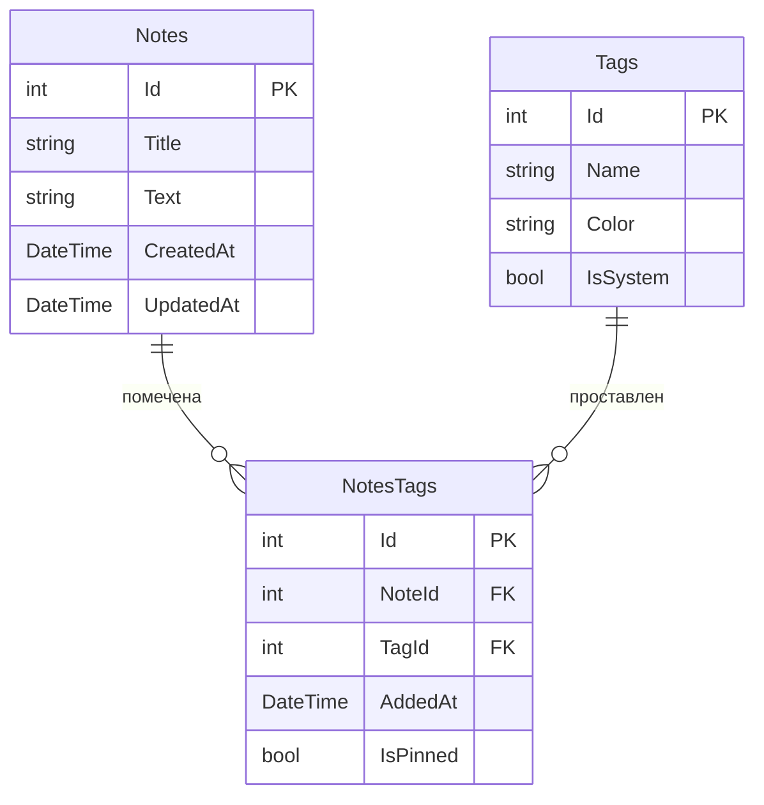

# Note (Заметки)
Приложение для записи информации

## Автор
Костиков Александр, РПО-24/1

## О проекте
Тема: Заметки с тегами

Название: Заметки

Это приложение для ведения личных заметок с тегами: одну заметку можно пометить несколькими тегами и также одним тегом можно пометить несколько заметок. Этим приложением будут пользоваться студенты, преподаватели и все остальные кто хочет записать информацию чтобы не забыть её. Приложение отличается тем, что у каждого тега есть свой цвет и дата привязки к заметке

## Схема базы

## Таблицы

### Notes 
Хранит заметки: заголовок, текст, дату создания и обновления

|Поле | Тип | Обязательное | Описание|
|-----|-----|--------------|---------|
| Id  | int | да | Первичный ключ|
| Title | string | да | Заголовок заметки|
| Text | string | да | Текст заметки |
| CreatedAt | DateTime | да | Дата и время создания |
| UpdatedAt | DateTime | нет | Дата и время обновления |

### Tags
Хранит теги, которыми помечают заметки

|Поле | Тип | Обязательное | Описание|
|-----|-----|--------------|---------|
| Id  | int | да | Первичный ключ|
| Name | string | да | Название тега |
| Color | string | нет | Цвет тега |
| IsSystem | bool | да | Встроенный тег или пользовательский |

### NotesTags
Связующая таблица: какой тег привязан к какой заметке и в каком порядке

|Поле | Тип | Обязательное | Описание|
|-----|-----|--------------|---------|
| Id  | int | да | Первичный ключ|
| NoteId | int | да | Внешний ключ -> Notes.Id |
| TagId  | int | да | Внешний ключ -> Tags.Id |
| AddedAt | DateTime | да | Дата привязки к заметке |
| IsPinned | bool | да | Закреплен ли тег на заметке |

## Связи
Таблица **Notes** связана с таблицей **NotesTags** через "NoteId" и таблица **Tags** связана с **NotesTags** через "TagId". Связь многие ко многим получилась, так как у одной заметки может быть несколько тегов и один тег может быть прикреплен к нескольким заметкам
